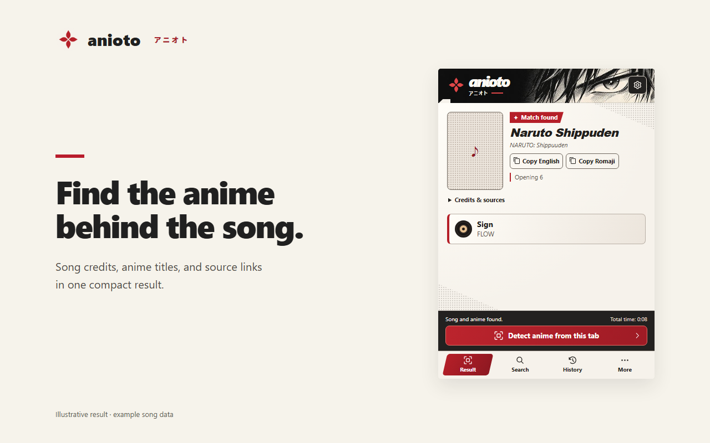
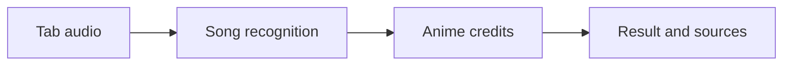

<div align="center">


# anioto · アニオト

**Find the anime behind the music playing in your browser.**

[Get started](#get-started) · [How it works](#how-it-works) · [Contribute](CONTRIBUTING.md) · [Privacy](PRIVACY.md) · [Report an issue](https://github.com/mfarhan08a/anioto/issues)

</div>

Anioto identifies a song from the current tab’s audio and looks up its documented anime connections. Results bring together anime artwork, English and romaji titles, song credits, and links to the sources.

> **Release status** · Version 0.10.5 is available as source for local development. Microsoft Edge store certification is in preparation. Generated store test packages contain placeholder service links. See the [release checklist](docs/STORE_RELEASE.md) and [verification record](docs/STORE_VERIFICATION.md).



Store descriptions, image specifications, and the other screenshots are in [the listing materials](docs/EDGE_STORE_LISTING.md).

## What you can do

| | |
| --- | --- |
| **Identify tab audio** | Start a scan while a video or stream plays. See the current step, elapsed time, and a cancel action. |
| **Find anime connections** | Look up opening, ending, insert-song, and documented cover or alternate-version connections. Possible matches show their supporting credits. |
| **Copy either anime title** | View English and romaji titles and copy either when available. |
| **Search by song** | Enter a known song title and artist to look up its anime credits. |
| **Revisit results** | Browse up to 100 recent results stored on your device in the Chromium popup. |
| **Check capture locally** | Play a short preview to check what the tab capture hears. |

Anioto finds anime associated with the music. Accuracy depends on recognition coverage and documented song credits. A recognized song can have several anime connections or none, and metadata services can become unavailable.

## Browser support

| Browser | Tab audio | Audio-file recognition | Manual song search |
| --- | --- | --- | --- |
| **Edge 120+** | Supported | — | Supported |
| **Chrome 120+** | Implemented; verify on your installed browser | — | Supported |
| **Firefox 128+ desktop** | — | Development workspace | Supported |
| **Safari** | — | Portable source build | Portable source build |

The automatic companion installer targets **Windows x64 and Chromium browsers**. Firefox and Safari have different setup requirements. Safari packaging and native testing remain pending. Read [browser support](docs/BROWSER_SUPPORT.md) for the tested scope and [cross-browser verification](docs/CROSS_BROWSER_VERIFICATION.md) for historical evidence.

## Get started

You need **Node.js 22.12 or newer**, npm, and Edge or Chrome. SongRec and Local Shazam also need the Windows companion. Internet access is required for recognition and anime metadata.

### 1. Build the extension

```sh
git clone https://github.com/mfarhan08a/anioto.git
cd anioto
npm ci
npm run build
```

In Edge, open `edge://extensions`, enable **Developer mode**, select **Load unpacked**, and choose `dist`. For Chrome, use `chrome://extensions` and choose `dist-chrome`.

### 2. Set up local recognition on Windows

Run these commands in PowerShell from the repository folder.

```powershell
.\scripts\setup-helper.ps1
.\scripts\setup-songrec.ps1
.\scripts\install-native-helper.ps1 -ExtensionId YOUR_EXTENSION_ID
```

Replace `YOUR_EXTENSION_ID` with the ID on your browser’s extension card. For both Edge and Chrome, add the other ID using `-AdditionalExtensionId`. These scripts install a private runtime under `local-data` and register the native launcher for your user account.

Open Anioto’s **Settings**, choose **SongRec**, and save. The local development build initially offers AudioTag, so choose SongRec explicitly. The separate store build defaults to SongRec. Opening Anioto starts an installed helper when a local provider is selected.

### 3. Find a song’s anime

Play a clear music section, open Anioto, and select **Detect anime from this tab**. SongRec starts checking after three seconds while listening continues, with longer samples up to twelve seconds when needed. A match stops capture automatically.

For troubleshooting and installation details, see [the installation guide](docs/INSTALL.md) and [helper setup](helper/README.md).

## Recognition providers

| Provider | Available in | Setup and behavior |
| --- | --- | --- |
| **SongRec** | Local and store builds | Default in the store edition. The Windows helper creates fingerprints locally and queries Shazam. |
| **Local Shazam / ShazamIO** | Local and store builds | Uses the same helper with the ShazamIO recognizer. Select it in Settings. |
| **AudD** | Store build | Optional cloud recognition through a configured Anioto server. Requires explicit upload consent. Production deployment is pending. |
| **AudioTag** | Local development build | Uses your personal API key and checks your account’s free allowance before an upload. |

Each scan uses its selected provider. SongRec and ShazamIO both use Shazam’s online catalog through unofficial integrations. Their coverage and availability depend on that service. Provider keys for the hosted AudD integration belong on the server.

## How it works



The resolver handles Japanese and romanized metadata, common recording suffixes, and documented aliases. Artist and credit checks distinguish confirmed associations, alternate recordings, and possible cover connections. A small source-backed supplement covers selected credits outside the main catalogs. See [the matching evidence](docs/VERSION_MATCHING_EVIDENCE.md) and [data-source implementation](src/providers/anime.ts).

## Develop and contribute

```sh
npm run build
npm run typecheck
npm run lint
npm test
```

| Directory | Purpose |
| --- | --- |
| `src` | Popup, settings, capture, recognition adapters, and anime lookup |
| `public` | Extension pages, styles, artwork, and manifest |
| `helper` | Local recognition service and native bridge |
| `server` | Optional AudD proxy and usage limits |
| `scripts` | Builds, setup, packaging, and verification tools |
| `tests` | Capture, lifecycle, provider, UI, and server regression tests |

The latest release-preparation checks passed 364 JavaScript tests and 30 helper tests. The full development-dependency audit still has findings. Current evidence and unverified release work are recorded in [store verification](docs/STORE_VERIFICATION.md).

Bug reports, documentation improvements, and pull requests are welcome. Read [CONTRIBUTING.md](CONTRIBUTING.md) for reproduction details and the checks to run. [Open an issue](https://github.com/mfarhan08a/anioto/issues/new) with the browser version, selected provider, and the exact status shown by Anioto.

## Privacy

Capture starts when you request it. Settings, history, and saved personal matches are stored on your device. Local recognizers send fingerprints to Shazam. Cloud recognizers receive a short audio sample after the applicable upload consent. Anime services receive song or anime metadata for lookup.

The [privacy policy](PRIVACY.md) explains each build’s data flow, temporary files, service providers, and data controls.

## License and acknowledgements

Anioto’s original code and documentation use the **[MIT License](LICENSE)**. You may use, modify, and redistribute that code, including commercially, while preserving its copyright and license notice.

SongRec uses GPLv3, and other third-party components retain their respective licenses. Redistribution of a Windows companion must include the required component notices and corresponding source. See [companion notices](docs/COMPANION-NOTICES.md). Music, anime artwork, and third-party metadata retain their respective rights and service terms.

Recognition is made possible by [SongRec](https://github.com/marin-m/SongRec), [ShazamIO](https://github.com/shazamio/ShazamIO), [AudD](https://audd.io/), and [AudioTag](https://audiotag.info/). Anime lookup uses [AnisongDB](https://anisongdb.com/), [AnimeThemes](https://animethemes.moe/), and [AniList](https://anilist.co/). Anioto is an independent project.
